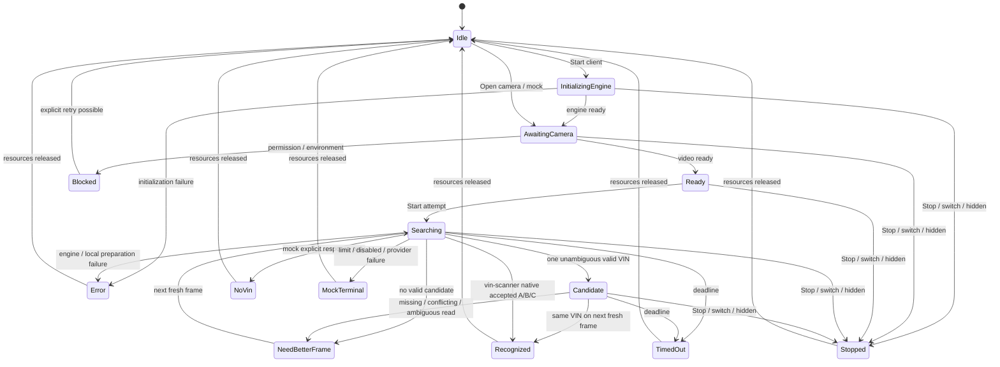

> Implementation amendment: [approved-changes.md](approved-changes.md) supersedes offline packaging, CSP, network and acceptance assumptions.

# Модель данных и состояний

Псевдотипы ниже — контракт проектирования, а не исполняемая реализация. Runtime OCR-ответ может содержать текст в памяти; export schema намеренно не разрешает его.

## Основные записи

| Запись | Поля и смысл |
|---|---|
| ViewState | activeTab: mock/client; engineId: paddle/tesseract/vin-scanner; phase; resultSource; текущие safe checks |
| RuntimeOwner | generation, engineId, cameraOwner baseline/native/null, component/worker reference, asset URLs, abort controller |
| RunContext | runId UUID, generation, mode, engineId/null, source, revisionAtStart, settings snapshot, start/deadline по performance.now, stopped/applied, inFlight 0/1, queue=0 |
| Frame | frameId UUID; source camera-live/camera-frozen/synthetic; width/height; Blob JPEG и RGBA в памяти; capturedAt; sourceVideoTime/null; frozenFrameId/null; owner generation |
| OcrResult | correlation runId/generation/engineId/frameId, items с text/score, engine version, inference times, completion status; схема `ocr-adapter.schema.json` |
| CandidateDecision | none/ambiguous/invalid/candidate; один VIN только в памяти; rejection categories; confidence с исходной шкалой |
| LiveConsensus | Только Paddle/Tesseract: previousFreshSourceTime, lastCandidate, consecutiveFreshMatches 0..2; у форка его собственный tracker без второго consensus host |
| ComparisonRow | engineId/version, frozenFrameId, timings, candidate count, formatValid, expectedMatch/null; распознанный текст виден только в UI |
| ExportReport | allowlist-проекция safe данных по `report-v2.schema.json`; исходные Frame/OcrResult/RunContext целиком не сериализуются |

runId и frameId — технические случайные UUID, не идентификаторы пользователя. deviceId/groupId камеры не попадают в отчёт и журнал. Настоящие VIN/ожидаемый VIN хранятся только в памяти поля/результата; хеш VIN тоже не экспортируется.

NativeVerdict форка: accepted, tier A/B/C/null, checkDigitOk/null, source auto/manual/null, decoder beam/greedy/unknown. VIN только в памяти. NativeAccepted не проходит FR11-фильтр Paddle/Tesseract. Native live использует полный кадр и штатный guide, frozen harness — явно обозначенный снимок.

## Состояния UI и runtime

Это локальные UI-состояния. Candidate → Recognized по двум кадрам относится только к Paddle/Tesseract. Форк признаётся по native accepted; loading_models/requesting_camera/scanning/processing_crop показываются как подфазы. Локальные фазы не добавляются в API enum. MockTerminal — группа, не новое значение.

Frozen: Ready → ProcessingImage → ImageResult/Error → Ready. У форка ImageResult может содержать native accepted/tier; host не блокирует его, источник остаётся frozen. Камера после снимка останавливается, bytes сохраняются при смене движка. Stop/смена вкладки/hidden/pagehide очищают bytes/строки, safe summary может оставаться.

## Адреса и передаваемые данные

| Откуда → куда | Данные | Реальный адрес |
|---|---|---|
| Camera track → video | Поток, только браузер | Нет HTTP-адреса |
| video → Canvas | RGBA область с учётом рамки | Операция памяти |
| Canvas → JPEG → FormData | frameId и image | Операция памяти |
| mock tab → in-memory mock | GET config; POST session; POST frame; DELETE session | Виртуальный `https://my-dev.tiss.ru/bff-b2bweb/v1/vin-recognition/...`, только текст в UI |
| client tab → worker | correlation metadata и image buffer/Blob | Локальный `blob:` worker, не сервер |
| embedded resource → WASM loader | JS/WASM/model bytes | В памяти или `blob:`, без HTTP(S) |
| worker → client tab | OCR items, timings, engine metadata | Worker message в памяти |
| report → download/clipboard | Только safe JSON | Blob download/Clipboard, без upload |

## Инварианты гонок

Перед публикацией любого результата одновременно проверяются:

1. generation/runId принадлежат текущему владельцу; активная вкладка и engineId совпадают.
2. Запуск не отменён, не завершён и не просрочен; `performance.now() < deadline`.
3. Для frame-based bridge frameId соответствует единственному ожидаемому кадру. Native live event не содержит frameId: его связывают с экземпляром компонента/generation/runId. Host не придумывает отсутствующий ID или inference timing.
4. Для записи VIN: revision поля равна revisionAtStart и applied=false.
5. Для live vote Paddle/Tesseract sourceVideoTime новее предыдущего: requestVideoFrameCallback предпочтителен, иначе currentTime без заявления точного sensor timestamp. Нативные голоса/исправления форка не фильтруются; source/число кадров — метаданные, не новый порог accepted.

Stop сначала повышает generation, затем освобождает ресурсы, для форка вызывает close. В его async camera/worker/retry/bitmap путях добавляется минимальная generation-защита: поздний stream сразу stop и не затрагивает нового владельца. Это lifecycle-правка, не изменение inference/consensus.

## Таймеры и ошибки

Инициализация: отдельный timeout 60 с, отменяемый. Попытка: default 30 с по монотонным часам. `remainingMs` виртуального сервера может только сократить deadline. Freeze processing ограничивается тем же 30-секундным бюджетом одной операции и не создаёт живого консенсуса.

Интервал означает `nextStart >= previousStart + captureIntervalMs` и запуск после завершения предыдущей обработки. Для мока также учитывается `nextCaptureAfterMs` как пауза от ответа. Ошибки FrameInProgress/FrameTooEarly вызывают ожидание и новый свежий frameId, остальные HTTP 400 завершают сценарий как RequestRejected; это локальный исход, не API status.

Пустое OCR-чтение означает no candidate/NeedBetterFrame; после дедлайна TimedOut. Native scan-vin-not-found после shutter показывается как native событие, не как серверный NoVin. NoVin — только явный виртуальный сценарий. EngineUnavailable, InitializationTimeout, FramePreparationError, EngineError — локальные diagnostic outcomes, не новые серверные статусы. Native greedy fallback остаётся доступным с честной отметкой decoder, без переопределения вердикта.
