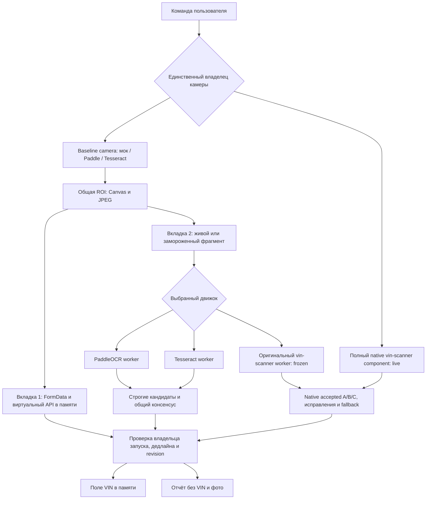

> Implementation amendment: [approved-changes.md](approved-changes.md) supersedes offline packaging, CSP, network and acceptance assumptions.

# План реализации

Документ описывает будущие изменения. В этом пакете они не выполнены.

## Цель и выбранный стек

Расширить HTML двумя вкладками и OCR. Мок/Paddle/Tesseract переиспользуют baseline camera/ROI/JPEG; vin-scanner запускает полноценный штатный компонент. Одновременно активны один владелец камеры и один OCR runtime.

UI: HTML5/CSS/обычный JavaScript, русский интерфейс, без framework. Runtime: MediaDevices, Video, Canvas, Blob, FormData, AbortController, Workers, WASM. OCR: PaddleOCR JS, Tesseract.js, полный native vin-scanner с beam/ngram/consensus. Build-time: Node >=20 и инструментарий форка с lockfile. Node/сервер на телефоне не нужен.

## Поток данных

Ветви не активны одновременно. Live-форк использует штатный полный кадр/guide и свою камеру; baseline camera закрыта. Frozen comparison даёт одинаковый снимок всем движкам, у форка — через оригинальный worker с consensus. Эти виды опыта имеют разные метки. Ни один путь не отправляет кадр на сетевой адрес.

## Изменения существующего HTML

Номера строк ниже относятся к frozen baseline; ориентироваться прежде всего на имена функций.

| Участок | Изменение | Что сохранить |
|---|---|---|
| CSP в head | После T01 разрешить только нужные встроенные worker/WASM/blob-механизмы; HTTP(S)/WS(S) не разрешать | Отсутствие внешних script/style/font и сетевого BFF |
| Верхняя разметка и `updateControls` (~217) | Добавить доступные tablist/tab panels и select трёх OCR, состояние подготовки движка | Existing camera/config controls, блокировки повторного старта |
| `openCamera` (~299), `listCameras`, `inspectCapabilities` | Передать владение общему run generation; при сменах останавливать и повторно включать только по кнопке | Поздний поток после отмены немедленно stop; rear camera, settings, необязательные controls |
| `prepareFrame` (~465) | Отделить чистое получение ROI/JPEG от показа и multipart; дать возвращаемому кадру source/frameId/video timestamp и владельца | Геометрия cover, качество/размер JPEG, резкость, проверка бюджета |
| `makeContext`, `canApplyResult` (~558) | Добавить mode/engineId/generation, initialization phase и проверку владельца всех async-результатов | Монотонный deadline, manual VIN revision, однократная запись |
| `mockOperation`, `mockCancel`, `runSession` (~571–679) | Сохранить одну реализацию; явно маркировать transport=memory и хранить безопасную трассу | Поля/статусы/400, idempotency и отсутствие очереди |
| `startScenario` (~687) | Оставить стартом вкладки мока; рядом добавить старт локальной попытки | Не превращать выбор режима в скрытый сетевой transport switch |
| `runSelfTests` (~736) | Сохранить прежние кейсы; добавить тесты режима/движка/позднего результата/консенсуса | Синтетические тесты не окрашивают реальные camera checks |
| `buildReport` (~769) | Version 2, раздельные категории, engine/run metadata, явная степень сетевого подтверждения | Редакция приватных данных, копирование и download fallback |
| Lifecycle (~831) | Общая функция stop для камеры, timer, mock, OCR worker и Blob URL | hidden/pagehide без автостарта |

Не писать новый camera manager, копию мока, HTTP abstraction или event bus. Переиспользуются готовые baseline camera и native component; host передаёт исключительное владение. Контракт трёх движков сохраняет native события, не заставляя форк притворяться raw OCR.

## Планируемые файлы при будущей разработке

Разработка идёт в пользовательском форке; B2B не участвует. Создаётся отдельная директория `apps/diagnostics` — это обоснованное новое приложение стенда, отделённое от существующего demo. Исходный пользовательский HTML остаётся frozen baseline до явной реализации; готовый файл первоначально выводится в отдельный build output, чтобы не затереть рабочую диагностику.

| Будущий файл | Назначение |
|---|---|
| `apps/diagnostics/index.html` | Перенесённая исходная разметка, две вкладки, static fallback, CSP |
| `apps/diagnostics/src/main.js` | Текущая логика с локальными изменениями: UI, камера, mock, run lifecycle, отчёт |
| `apps/diagnostics/src/ocr/paddle.js` | Инициализация официального JS OCR, предсказание, нормализация метаданных, dispose |
| `apps/diagnostics/src/ocr/tesseract.js` | Один Tesseract worker, eng/SINGLE_LINE/whitelist, terminate |
| `apps/diagnostics/src/ocr/vin-scanner.js` | Полный component bridge; frozen bridge к исходному worker; владение, deadline и revision |
| `packages/vin-scanner/src/element/vin-scanner.js` | Только generation/lifecycle после async awaits, безопасный retry и обработка отказа video.play |
| `packages/vin-scanner/src/element/i18n.js` | RU в существующем i18n без удаления других языков |
| `apps/diagnostics/scripts/build-standalone.mjs` | Замыкание зависимостей, embedding, manifest, контроль отсутствующих ресурсов и выпуска одного HTML |
| `apps/diagnostics/assets-manifest.json` | Точные версии/хеши всех JS/WASM/моделей/словарей; заполняется фактическими данными |
| Ближайшие существующие `*.test.js` / diagnostics tests | Значимые проверки race/strict consensus/contract; без тестов, повторяющих DOM-разметку |
| `apps/diagnostics/README.md` | Сборка, поддержанные среды, проверки и лицензии |
| Корневой package/lockfile | Только необходимые workspace script и закреплённые зависимости |

Core pipeline/consensus/ngram/beam и веса не переписываются. Используется штатный web component целиком; frozen harness запускает исходный scanner.worker.js. При необходимости наблюдаемости worker дополняется безопасными метаданными без изменения accepted. Алгоритмическое совпадение проверяется с pinned исходником.

## Инициализация и обработка

1. Выбор вкладки/движка обновляет только UI. Загрузка ресурсов начинается по команде пользователя. Невыбранные движки не декодируются и не инициализируются.
2. Для локального режима сначала проверить минимальные API и инициализировать выбранный worker (лимит 60 с). Отдельно показать загрузку/декодирование/создание сессий и cold startup. Ничего не отправлять наружу.
3. Paddle/Tesseract запускают baseline camera после init. Форк вызывает original open() с embedded URLs и ngram-src; native states показывают loading/requesting/scanning. Проверить video.play; при отказе показать продолжение/retry, не проглатывать ошибку.
4. Revision запомнить уже по Start. После готовности камеры запустить deadline. Paddle/Tesseract ждут свежий кадр без очереди; форк сохраняет native pump/burst/consensus и interval 200 мс. Host не меняет голоса и пороги.
5. Frozen comparison: один JPEG/пиксели на всех движках. Форк получает bitmap через оригинальный FRAME, guideRect/manual по выбранному тесту. RESET перед отдельным frozen опытом, не между кадрами live. Повтор одного снимка не объявляется независимыми live-кадрами.
6. Проверить correlation и deadline до и после подготовки, inference и нормализации. Сохранить только один новый результат; не накапливать backlog.
7. Paddle/Tesseract используют строгий фильтр и два свежих совпадения. Native scan-vin-found/worker accepted принимается без дополнительного фильтра, включая Tier C/исправления. Frozen accepted подписан как native вердикт на снимке. Запись поля защищена revision/владельцем.
8. Любое завершение останавливает ресурсы. Дальнейшая попытка — явный новый запуск.

## Детали движков

**PaddleOCR.** Стартовать с tiny det/rec через официальный `PaddleOCR.create`, `worker: true`, WASM backend, один поток. Список объектов `predict` свести к строкам `items.text`; не предполагать один объект вместо массива. Сохранить geometry/score только в оперативной диагностике, не в публичном отчёте. Настроить локальные URL всей ресурсной цепочки OpenCV/ORT/моделей и проверить, что dispose действительно завершает worker.

**Tesseract.** Создать один worker на выбранный активный runtime, язык eng, LSTM, SINGLE_LINE и VIN whitelist. Не создавать worker для каждого кадра. Исходную confidence хранить со шкалой 0–100; trim/newline не превращать в склейку нескольких строк. Случай длинной строки без отдельного 17-символьного read не принимать. При остановке вызвать terminate и отвергнуть все pending callbacks.

**vin-scanner.** Полный оригинальный компонент: detector/rec/dict/wasm/ngram attributes, overlay/quad/shutter, manual burst трёх кадров, guide strips, torch, autofocus, retry/hint. Сохранить beam, rescoring, исправление длины, Tier A/B/C и native thresholds. Принять scan-vin-found.detail как итог: vin/confidence/tier/checkDigitOk/source. Показать decoder beam/greedy; штатный greedy fallback не скрывать. Frozen использует исходный worker, не сокращённый core. Native parity — обязательная отдельная проверка.

## Ресурсы и безопасность автономности

Build может скачивать зависимости на машине разработчика; итоговый файл — нет. Для каждого asset фиксируются источник, версия, SHA-256, размер и лицензия. JS-worker entry bundle должен включать все imports. ORT companion MJS/WASM и Tesseract core должны соответствовать JS-версии; объединение разных WASM наугад запрещено.

Точные настройки загрузчиков и CSP сначала доказываются в T01, затем закрепляются в manifest/build. `blob:` URL создаются только из embedded bytes, отслеживаются по владельцу и отзываются после прекращения работы. Сохранять ресурс URL до окончания использующего его loader; преждевременный revoke тоже ошибка. Ни Service Worker, ни IndexedDB, ни обязательный кэш не нужны для автономности; холодный первый запуск обязан работать без них.

HTTP-вызовы ловятся кодовой проверкой, сетевым логом браузера и CSP. Счётчик приложения считается наблюдением приложения, не доказательством отсутствия всех сетевых пакетов. В отчёте нельзя выдавать `not_performed` независимой проверки за `pass`.

## Последовательность и контроль изменений

Сначала доказать загрузку ресурсов и воспроизводимость, затем переиспользовать baseline, затем по одному подключить движки, после этого сравнение/отчёт и регрессии. Подробные задачи и стоп-условия — в [tasks.md](tasks.md). Контракты меняются прежде реализации. В ходе разработки обновляются затронутые FR/AC/контракты; обходной server/CDN fallback не добавляется.
